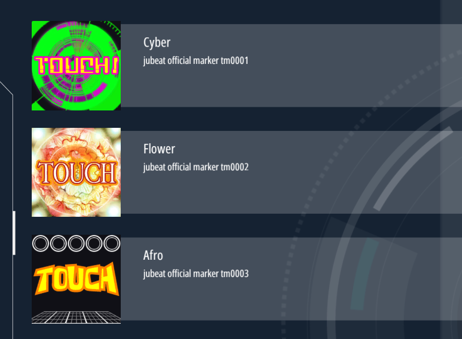
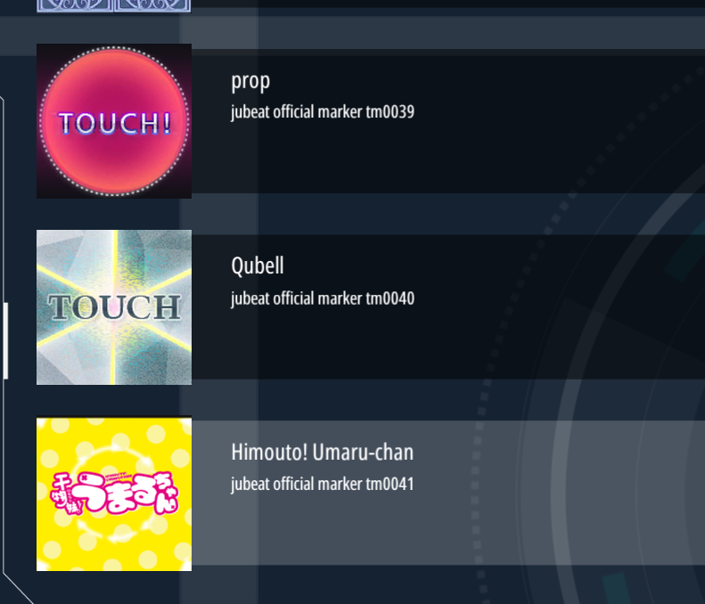

# JCV-Marker — jubeat 官方 marker 的 Malody 4.3.7 移植

把 jubeat 的 58 种官方 marker 逐帧贴图，转换成 Malody 4.3.7（Pad 模式）可用的皮肤包。

每套皮肤包含面板、长按两段三角、MA 标记动画、H1–H4 四档打击动画和封面；
帧数统一为 MA 24 帧 / H 16 帧，以适配 Malody 4 的固定帧率播放。

这不是官方移植，只是一次格式转换：图形全部来自 jubeat 原素材，
只调整了帧序列和打包方式。

## Credits

贴图数据与时序模型来自 **Thregren / jubeat-chart-viewer**：

https://github.com/Thregren/jubeat-chart-viewer

（`marker/jubeat_official` 的逐帧贴图与 `manifest.json`）

Copyright (c) 2026 Thregren，MIT License，全文见 [THIRD_PARTY_NOTICES.md](THIRD_PARTY_NOTICES.md)。

面板与长按三角沿用社区皮肤 **Jubeat-闪电门（HOLD版）** 的素材，感谢原作者。

## 声明

jubeat 及相关美术资源版权归 KONAMI 所有。本项目为非商业粉丝转换，
与 KONAMI 无关联；如有侵权请告知，会立即删除相关资源。
